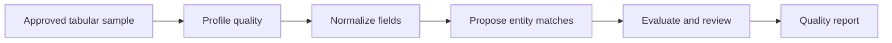

# Tabular Cleaning and Entity Resolution

Planned Python portfolio project for cleaning inconsistent records and reviewing likely duplicate entities.

**Status: project brief and repository setup only.** No cleaning engine, entity matcher or performance benchmark has been implemented. This repository is not yet a finished service demonstration.

## Intended showcase

Start with a bounded, permitted public tabular sample. Normalize text and dates, report missing values and quality issues, then propose entity matches for review against a small labeled reference set. Measure larger-volume behavior only after the sample is correct.

| Planned deliverable | Evidence needed |
| --- | --- |
| Cleaning rules and change report | Counts reconcile with the input; originals remain unchanged |
| Candidate entity matches | Labeled examples and precision/recall with an explicit review threshold |
| Reproducible run | Source provenance, setup instructions and tests |
| Scaling case study | Stated machine, row count, elapsed time and measured memory |

This diagram describes the proposed workflow.

## Repository contents

- [PROJECT_BRIEF.md](PROJECT_BRIEF.md): intended scope, completion criteria and evidence requirements.
- [GUIDANCE.md](GUIDANCE.md): implementation guidance and package decisions.
- `environment.yml`: minimal Python/pytest setup; processing libraries are intentionally deferred.

No dataset, credentials, generated records or claimed client results are included. The local Veyra workspace can use its shared Conda environment for this project. A separate clone can create its own environment later with `conda env create --prefix ./.conda --file environment.yml`.

## Next milestone

Select the source and define a small labeled entity-matching evaluation before implementing the cleaning engine. Source selection and benchmark results will be recorded when actually completed.
